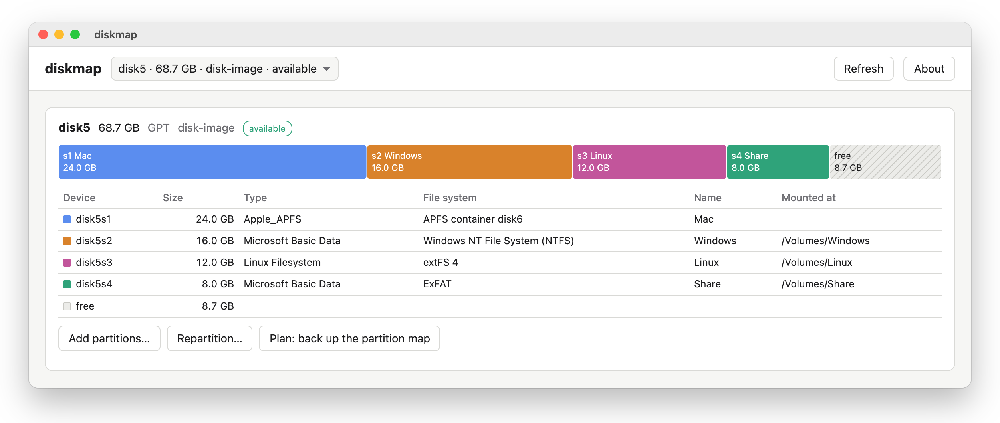
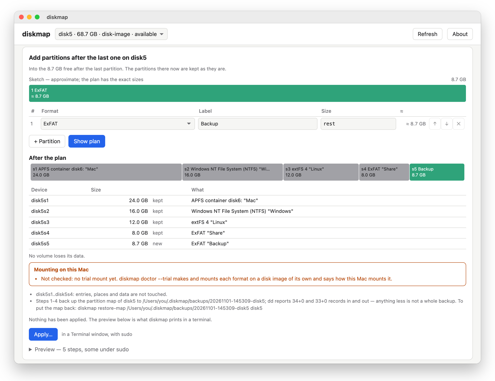
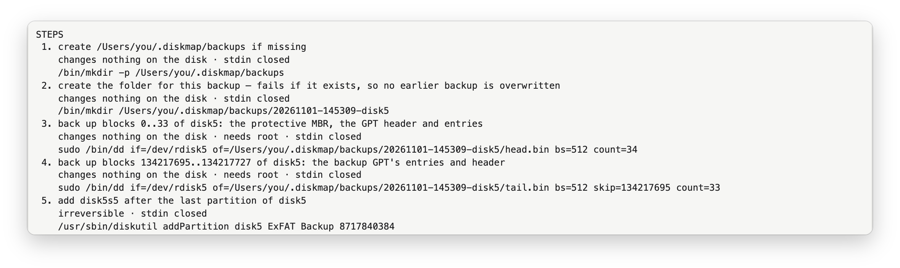

<p align="center">
  
</p>

<h1 align="center">diskmap</h1>

<p align="center">
  A partition map and layout planner for external drives on macOS.<br>
  Every change is a <code>diskutil</code> command you see before it runs.
</p>

<p align="center">
<picture>
  <source media="(prefers-color-scheme: dark)" srcset="assets/screenshots/map-dark.png">
  
</picture>
</p>

---

## Why

Disk Utility can split a drive into several partitions only for APFS, HFS+, exFAT and FAT.
`diskutil` in Terminal can do much more, including NTFS and ext4 through third-party
formatters, but it draws no picture, previews nothing, and expects you to keep its size
syntax, the order of operations and their consequences in your head.

diskmap closes that gap. It shows the partitions of a drive as a map, lets you lay them
out, and turns the layout into a plan: a list of ordinary commands, each marked as
reversible, irreversible or destroying a volume. You read the plan, then apply it — or
copy it and run it by hand. The commands are the feature, not an implementation detail.

## What it does

- **Show** every partition of every disk: offsets, sizes, file systems, labels, free space.
- **Repartition** an external drive, **add** partitions after the last one or into a gap,
  **shrink** or **grow** an APFS or HFS+ partition in place.
- **Format** with what macOS provides (APFS, HFS+, exFAT, FAT32) and with third-party
  tools when they are installed: NTFS (ntfsprogs or Paragon), ext4 (e2fsprogs or Paragon).
  `diskmap doctor` tells apart "a format can be created" from "a volume of it then mounts".
- **Back up and restore** the partition map before every write; a journal records each run.
- **Mount and unmount** partitions.
- Works from the command line (`diskmap show | plan | apply | doctor | …`) and from a window
  — `diskmap.app`, or the same page in a browser with `diskmap ui` — that draws the map,
  edits the layout and opens the plan in Terminal.

## How it looks

Lay out what you want, and diskmap shows what the drive will look like after the plan, what is kept,
what is new and what is lost — here, a new ExFAT partition in the free space at the end:

<picture>
  <source media="(prefers-color-scheme: dark)" srcset="assets/screenshots/plan-dark.png">
  
</picture>

Every plan is a list of commands, each marked as changing nothing, reversible or irreversible.
This is what the plan above runs — first a backup of the partition map, then one `diskutil` call:

<picture>
  <source media="(prefers-color-scheme: dark)" srcset="assets/screenshots/steps-dark.png">
  
</picture>

The screenshots are of a disk image, the way diskmap is tested: no real drive was changed for them.

## How it keeps your disks safe

- **Plan → Preview → Apply.** Nothing is written without a plan you have seen.
  The preview can be pasted into Terminal and does the same thing.
- **Read-only by default.** Writing is a separate command that runs under `sudo`
  in Terminal and asks you to type the disk's name — and, when a volume is destroyed, its label.
- **Internal and startup disks are never changed.** They are shown, read-only, with the
  reason. A disk can be changed only when it is positively known to be external.
- **The partition map is backed up before every change** — the map, not the files on it.
  Back up anything you cannot lose before you change a drive.
- **No code of its own writes to a disk.** Every change is made by tools that come with
  macOS — `diskutil` above all — or by the formatter a file system needs.
- **No network.** diskmap sends nothing anywhere. `diskmap ui` listens on `127.0.0.1` only.

## Install

diskmap is installed with [Homebrew](https://brew.sh) and built from source on your Mac.
It needs Apple silicon and macOS 15 or later. It is tested on macOS 26; on another version
every plan says so first, because `diskutil` there may do what the plan does not predict.

```sh
brew install zapotylok/diskmap/diskmap
```

That gives you the `diskmap` command and the window, `diskmap.app`. To find the window in
Launchpad and Spotlight, put it into Applications:

```sh
diskmap install-app
```

It copies the window into `/Applications`, or `~/Applications` if you cannot write there
(`--to FOLDER` for another place). The copy runs the `diskmap` Homebrew installed, so after
`brew upgrade diskmap` it runs the new version; run `diskmap install-app` again when you
want the newest window itself.

**NTFS and ext4** need a formatter diskmap does not install: `mkntfs` from
[ntfs-3g](https://github.com/tuxera/ntfs-3g) or Paragon's Microsoft NTFS for Mac; `mke2fs`
from `brew install e2fsprogs` or Paragon's extFS for Mac. `diskmap doctor` shows which
formats you can create here and which of them macOS can then mount.

**Why Homebrew and not a download.** A downloaded app has to be signed with an Apple
Developer ID and notarized, or macOS refuses to open it; that will come later. Homebrew
builds diskmap on your Mac from this repository's source, and macOS runs what was built on
it without asking.

**One thing to know about `sudo`.** Writing to a disk is `sudo diskmap apply …`, which runs
diskmap's code from Homebrew's folder as root. That folder is writable by your user, as it is
for every Homebrew tool you run with `sudo`.

To remove it: `brew uninstall diskmap`, and delete `diskmap.app` from Applications.

## Getting started

```sh
diskmap show            # every disk and partition, as a map
diskmap doctor          # which formats can be created and mounted here
diskmap install-app     # the window, into Applications
open -a diskmap         # and open it
```

In the window, pick an external drive, lay out its partitions and press **Show plan**. Nothing
is written until you press **Apply…**: it opens Terminal with `sudo diskmap apply`, which
shows the plan once more and asks you to type the disk's name — and, when a volume is
destroyed, its label.

## Try it on a disk image

Before you change a real drive, try diskmap on a disk image: macOS treats it as a disk, and
diskmap shows it as `available: disk image`. Nothing on your drives is touched.

```sh
hdiutil create -size 8g -type SPARSE -layout NONE ~/diskmap-test   # a file that grows as it fills
hdiutil attach -nomount ~/diskmap-test.sparseimage                   # prints its name, e.g. /dev/disk4
```

Lay it out in the window or with `diskmap plan` / `sudo diskmap apply`, as you would a drive.
When you are done, eject it and delete the file:

```sh
hdiutil detach disk4
rm ~/diskmap-test.sparseimage
```

## Status

diskmap is young and in active development. Each release is a tag of this repository and
the source Homebrew builds from; the work in between happens elsewhere, so the history here
is one commit per release.

It is developed and tested on macOS 26 on Apple silicon; it runs on macOS 15 and later.

## Versions

A version is the date of its release: `2026.1031` is October 31, 2026. A second release on
the same day adds `.2`. You can tell at a glance how fresh a build is.

## Feedback and support

Questions, bugs and ideas: [open an issue](../../issues) or write to
[lexx.vit@gmail.com](mailto:lexx.vit@gmail.com?subject=diskmap).

diskmap is free. If it saved you some time, you can
[buy me a coffee](https://buymeacoffee.com/VitaliZapatylak).

## Authors

Vitali Zapatylak and Claude (Anthropic).

## License

[MIT](LICENSE). diskmap comes with no warranty: changing a partition map can destroy data.
